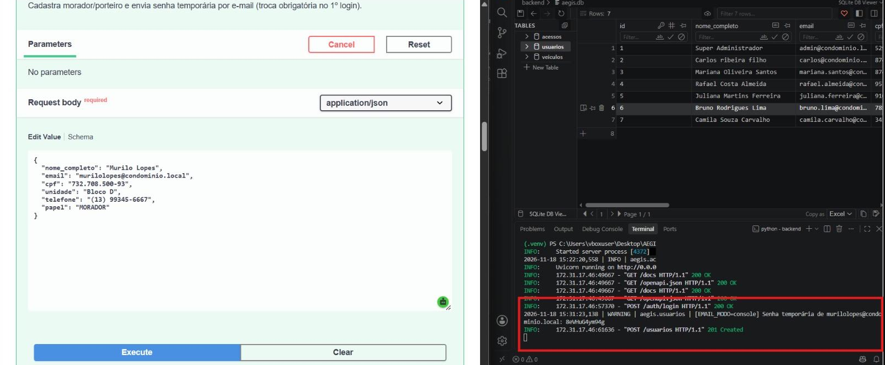
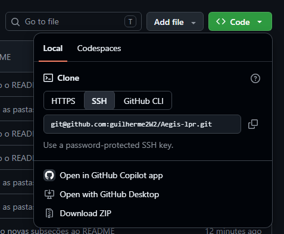

# <h1 align = "center"> **Projeto Integrador - AEGIS-LPR**  </h1>

<div align = "center">



### Status do Projeto: Em Andamento (45%) 🚧

*Última Atualização em 21/11/2026*

</div>
<br>

## 🗂 Sumário

- [📝 Apresentação](https://github.com/guilherme2W2/Aegis-lpr/tree/main#-apresenta%C3%A7%C3%A3o)
- [🎯 Objetivos do Projeto](https://github.com/guilherme2W2/Aegis-lpr/tree/main#-objetivos-do-projeto)
- [⚙ Funcionalidades](https://github.com/guilherme2W2/Aegis-lpr/tree/main#-funcionalidades)
    - [🚘 Reconhecimento de Placas](https://github.com/guilherme2W2/Aegis-lpr/tree/main#-reconhecimento-de-placas)
    - [👥 Gerenciamento de Usuários e Veículos](https://github.com/guilherme2W2/Aegis-lpr/tree/main#-gerenciamento-de-usu%C3%A1rios-e-ve%C3%ADculos)
    - [🔐 Controle de Acesso e Autenticação](https://github.com/guilherme2W2/Aegis-lpr/tree/main#-controle-de-acesso-e-autentica%C3%A7%C3%A3o)
    - [📋 Histórico de Acessos](https://github.com/guilherme2W2/Aegis-lpr/tree/main#-hist%C3%B3rico-de-acessos)
- [💻 Tecnologias Utilizadas](https://github.com/guilherme2W2/Aegis-lpr/tree/main#-tecnologias-utilizadas)
- [🔨 Arquitetura do Back-End](https://github.com/guilherme2W2/Aegis-lpr/tree/main#-arquitetura-do-back-end)
- [📂 Estrutura das Pastas](https://github.com/guilherme2W2/Aegis-lpr/tree/main#-estrutura-das-pastas)
- [📃 Requisitos para Instalação](https://github.com/guilherme2W2/Aegis-lpr/tree/main#-requisitos-para-instala%C3%A7%C3%A3o)
  - [🔹 Requisitos de Ambiente](https://github.com/guilherme2W2/Aegis-lpr/tree/main#-requisitos-de-ambiente)
  - [🔹 Dependências da Aplicação](https://github.com/guilherme2W2/Aegis-lpr/tree/main#-depend%C3%AAncias-da-aplica%C3%A7%C3%A3o)
  - [🔹 Dependências de Desenvolvimento e Testes](https://github.com/guilherme2W2/Aegis-lpr/tree/main#-depend%C3%AAncias-de-desenvolvimento-e-testes)
- [🔑 Acesso e Clonagem do Projeto](https://github.com/guilherme2W2/Aegis-lpr/tree/main#-acesso-e-clonagem-do-projeto)
- [💻 Instalação e Configuração do Ambiente](https://github.com/guilherme2W2/Aegis-lpr/tree/main#-instala%C3%A7%C3%A3o-e-configura%C3%A7%C3%A3o-do-ambiente)
- [📥 Instalação das Dependências](https://github.com/guilherme2W2/Aegis-lpr/tree/main#-instala%C3%A7%C3%A3o-das-depend%C3%AAncias)
- [⚙ Configuração das Variáveis de Ambiente](https://github.com/guilherme2W2/Aegis-lpr/tree/main#-configura%C3%A7%C3%A3o-das-vari%C3%A1veis-de-ambiente)
- [💾 Configuração do Banco de Dados](https://github.com/guilherme2W2/Aegis-lpr/tree/main#-configura%C3%A7%C3%A3o-do-banco-de-dados)
- [▶️ Abrir e Executar o Projeto](https://github.com/guilherme2W2/Aegis-lpr/tree/main#%EF%B8%8F-abrir-e-executar-o-projeto)
- [🗞 Licença](https://github.com/guilherme2W2/Aegis-lpr/tree/main#-licen%C3%A7a)
- [👨🏻‍💻 Integrantes](https://github.com/guilherme2W2/Aegis-lpr/tree/main#%E2%80%8D-integrantes)
- [✨ Contatos & Referências](https://github.com/guilherme2W2/Aegis-lpr/tree/main#-contatos--refer%C3%AAncias)
<br>


## 📝 Apresentação

A **Segurança Pública** sempre está presente nas conversas do dia a dia. Seja na rua, no metrô, no trabalho ou até em casa com a família, comentários a respeito desse tema são recorrentes. Segundo o levantamento Nexus/BTG divulgado pelo portal [Metrópoles](https://www.metropoles.com/sao-paulo/seguranca-publica-eleicoes-2026), aproximadamente 30% dos brasileiros apontaram a segurança pública, a violência e a criminalidade como suas principais preocupações nacionais, seguidas pela corrupção (24%) e pela saúde (23%). Com o crescimento das áreas urbanas e a necessidade de aprimorar continuamente os mecanismos de segurança, soluções tecnológicas de automação apresentam oportunidades para tornar esse processo mais eficiente, organizado e rastreável.

É nesse contexto que a nossa equipe de desenvolvimento apresenta o **AEGIS-LPR (*License Plate Recognition*)**, um sistema inteligente de controle e automação de acesso veicular desenvolvido com o propósito de otimizar o gerenciamento de entradas e saídas em condomínios residenciais.

A solução utiliza tecnologias de processamento de imagens e reconhecimento óptico de caracteres (*OCR*) para identificar as placas de veículos e verificar sua autorização de acesso com base em registros previamente cadastrados. A partir dessa identificação, o sistema realiza a validação das informações, registra as movimentações e disponibiliza em um histórico de acessos para consulta e gerenciamento. 

Além da automatização do processo de identificação, o **AEGIS-LPR** busca proporcionar maior organização administrativa, rastreabilidade das movimentações e centralização das informações, contribuindo para uma gestão mais eficiente do controle de acesso veicular e atendendo às demandas de condomínios e conjuntos habitacionais, especialmente em grandes centros urbanos, como São Paulo.

O nosso projeto integra conhecimentos de **Engenharia da Computação**, especialmente nas áreas de desenvolvimento de software, integração de sistemas, processamento de imagens e gerenciamento de bancos de dados. Sua concepção e desenvolvimento fazem parte das atividades acadêmicas do curso de Bacharelado em Engenharia da Computação, conciliando a aplicação prática dos conhecimentos adquiridos com o desenvolvimento de uma solução tecnológica para um problema real.

> [!IMPORTANT]
> Por se tratar de um Projeto de Extensão e Aprendizado, o desenvolvimento da nossa aplicação será realizado de forma gradual, acompanhando a matriz curricular e as etapas previstas na grade do nosso curso. Por isso, cada semestre contemplará o desenvolvimento de uma parte específica do projeto, permitindo a aplicação prática dos conhecimentos adquiridos ao longo da graduação.
> Neste semestre, os trabalhos foram concentrados na estruturação e no desenvolvimento do Back-End. A conclusão da aplicação está prevista para dezembro de 2028.
<br>

## 🎯 Objetivos do Projeto

Este projeto tem por objetivo desenvolver um sistema inteligente de controle e automação para acesso veícular em residências, condomínios e conjuntos habitacionais. Foi utilizadas tecnologias de reconhecimento de placas, processamento de imagens e gerenciamento de bancos de dados. O sistema busca identificar veículos, verificar suas permissões de acesso e registrar suas movimentações, contribuindo para a organização e o gerenciamento. Para a finalidade de gerenciamento e controle, os objetivos foram separados em partes:

- a) Reconhecimento de placas: implementar mecanismos de processamento de imagens e reconhecimento óptico de caracteres (OCR) para identificar placas veiculares; ✔
- b) Gerenciamento de veículos e usuários: permitir o cadastro, a consulta, a atualização e a exclusão de informações de moradores, funcionários e veículos; ✔
- c) Validação de acesso: verificar se os veículos identificados possuem autorização para entrar no condomínio, de acordo com os registros cadastrados; ✔
- d) Registro de movimentações: armazenar informações sobre entradas e saídas, mantendo um histórico de acessos para consultas posteriores; ✔
- e) Gerenciamento de informações: centralizar os dados de usuários, veículos e movimentações em um banco de dados, garantindo sua organização e disponibilidade; ✔
- f) Desenvolvimento da API: estruturar uma interface de comunicação entre os componentes do sistema, permitindo a integração dos recursos de reconhecimento, validação e gerenciamento; ✔
- g) Confiabilidade do sistema: desenvolver e executar testes para verificar o funcionamento dos recursos implementados e a consistência das informações armazenadas. ✔
<br>

## ⚙ Funcionalidades

O AEGIS-LPR contará com esse conjunto de funcionalidades voltadas à identificação de veículos, ao gerenciamento de cadastros e ao controle de acesso em condomínios residenciais:

### 🚘 Reconhecimento de Placas

- Identificação das placas veiculares por meio do processamento de imagens;
- Detecção da região da placa utilizando modelos de visão computacional;
- Reconhecimento dos caracteres presentes na placa por meio de um OCR.

### 👥 Gerenciamento de Usuários e Veículos

- Cadastro de moradores e funcionários;
- Cadastro de veículos de diferentes modalidades de acordo com as necessidades de cada condomínio (Modalidade A e B inicialmente);
- Consulta e visualização dos veículos cadastrados;
- Atualização e exclusão de registros no histórico;
- Verificação da situação do veículo e de sua autorização de acesso.

### 🔐 Controle de Acesso e Autenticação

- Validação das placas reconhecidas;
- Verificação da autorização de entrada do veículo;
- Registro das tentativas de acesso, conforme o resultado da validação;
- Armazenamento das movimentações de entrada e saída;
- Autenticação de usuários para acesso aos recursos protegidos da API;
- Validação das informações recebidas pelo sistema.

### 📋 Histórico de Acessos

- Registro de data e horário das movimentações;
- Consultas aos registros de acesso;
- Identificação dos veículos envolvidos nas movimentações;
- Disponibilização do histórico para acompanhamento e gerenciamento;
<br>

## 💻 Tecnologias 


## 🔨 Arquitetura do Back-End

<div align = "center">
    
</div>
<br>

O Back-End do **AEGIS-LPR** foi estruturado em *Python*, utilizando o framework *FastAPI* para disponibilizar os recursos da aplicação por meio de uma *API REST*. Sua arquitetura organiza os componentes em camadas, separando as responsabilidades de comunicação, validação, processamento das regras de negócio e persistência dos dados.

Essa organização busca facilitar a manutenção do código, a integração entre os módulos e a evolução do projeto ao longo de seu desenvolvimento.

Para mais informações, checar o arquivo ```arquitetura.md``` na pasta *docs*.

### Organização das Camadas

O Back-End está dividido nos seguintes componentes:

- **Core (`core/`):** concentra as configurações gerais da aplicação e os parâmetros necessários para seu funcionamento.
- **Database (`database/`):** responsável pela configuração da conexão com o banco de dados e pelo gerenciamento das sessões utilizadas pela aplicação.
- **Models (`models/`):** define as entidades e estruturas que representam os dados armazenados no banco de dados, como usuários, veículos e acessos.
- **Repositories (`repositories/`):** organiza as operações de consulta, inserção, atualização e exclusão de dados, intermediando a comunicação entre os serviços e a camada da persistência.
- **Routers (`routers/`):** define os endpoints da API e recebe as requisições do HTTP, encaminhando-as para os componentes responsáveis pelo processamento.
- **Schemas (`schemas/`):** estabelece os formatos dos dados recebidos e enviados pela API, realizando a sua validação e estruturação.
- **Services (`services/`):** concentra as regras de negócio e os processos da aplicação, incluindo reconhecimento de placas, validação e controle de acesso.
- **Utils (`utils/`):** reúne as funções auxiliares e recursos reutilizáveis por diferentes componentes do sistema.
- **Tests (`tests/`):** contém os testes automatizados utilizados para verificar o comportamento e a confiabilidade dos recursos implementados.

### Fluxo de Funcionamento

De maneira geral, uma requisição à API percorre as seguintes etapas:

1. **Recebimento:** o Router recebe a requisição HTTP por meio de um endpoint.
2. **Validação:** os Schemas verificam e estruturam os dados recebidos.
3. **Processamento:** os Services executam as regras de negócio e coordenam as operações necessárias.
4. **Persistência:** quando necessário, os Repositories e Models participam das operações de consulta ou alteração dos dados no banco.
5. **Resposta:** o resultado do processamento é devolvido ao cliente por meio da API.

No processo de reconhecimento veicular, os serviços de processamento de imagens integram as tecnologias YOLO e EasyOCR para detectar as placas e reconhecer seus caracteres. As informações identificadas são encaminhadas ao processo de validação de acesso, que consulta os registros do sistema e determina o resultado da verificação.

> [!NOTE]
> A arquitetura apresentada representa a organização lógica do Back-End. A implementação e a integração dos componentes podem evoluir conforme as etapas acadêmicas previstas para o desenvolvimento do AEGIS-LPR.
<br>

## 📂 Estrutura das Pastas

```
/backend

    /app
        /core
            config.py
            description.md

        /database
            database.py
            description.md
            session.py

        /models
            __init__.py
            acesso.py
            description.md
            usuario.py
            veiculo.py

        /repositories
            description.md

        /routers
            __init__.py
            acessor.py
            autenticacao.py
            description.md
            usuarios.py
            veiculos.py

        /schemas
            __init__.py
            acesso.py
            autenticacao.py
            description.md
            usuario.py
            veiculo.py

        /services
            __init__.py
            controle_acesso.py
            description.md
            reconhecimento,py
            validacao.py

        /utils
            __init__.py
            formatacao.py

        __init__.py
        AEGIS-LPR - Atalho.lnk
        database.py
        main.py
        security.py

        /venv

/docs
    arquitetura.md
    controle_acesso.md
    endpoints.md

/imgs

/tests
    __init__.py
    test_acessos.py        
    test_reconhecimento.py
    test_usuarios.py
    test_veiculos.py

.env.example
.gitignore
condominio.sql
README.md
requirements.txt
```
<br>

## 📃 Requisitos para Instalação

*Para executar o AEGIS-LPR, é necessário possuir os seguintes recursos e ferramentas instalados:*

### 🔹 Requisitos de Ambiente

- **Python:** versão 3.10 ou superior.
- **Banco de Dados:** MySQL 8 ou MariaDB, conforme a configuração adotada.
- **Modelo YOLO:** modelo de detecção de placas no formato `.pt`, necessário para o processamento e reconhecimento das imagens. 

> [!NOTE]
> O arquivo do YOLO não está incluído diretamente no repositório.

### 🔹 Dependências da Aplicação

As bibliotecas utilizadas no desenvolvimento e na execução do backend estão relacionadas no arquivo `requirements.txt`, incluindo:

- **FastAPI:** construção da API.
- **Uvicorn:** execução do servidor ASGI.
- **Pydantic:** validação e estruturação dos dados.
- **SQLAlchemy:** gerenciamento da comunicação com o banco de dados por meio de ORM.
- **PyMySQL:** conexão com o banco de dados MySQL.
- **cryptography:** suporte criptográfico para autenticação na conexão com o MySQL.
- **python-dotenv:** gerenciamento das variáveis de ambiente.
- **OpenCV:** processamento e manipulação de imagens.
- **Ultralytics:** execução do modelo YOLO para detecção de placas.
- **EasyOCR:** reconhecimento óptico dos caracteres das placas.

### 🔹 Dependências de Desenvolvimento e Testes

- **pytest:** execução e gerenciamento dos testes.
- **httpx:** suporte às requisições HTTP utilizadas nos testes da API.

> A instalação das dependências será realizada conforme as instruções disponíveis na seção Instalação das Dependências.
<br>

## 🔑 Acesso e clonagem do projeto

O código-fonte do AEGIS-LPR está disponível publicamente neste repositório. Para obter uma cópia local do projeto e acompanhar seu desenvolvimento, siga as instruções abaixo:

### 1) Acessando o Repositório

Acesse o repositório oficial do projeto clicando [aqui](https://github.com/guilherme2W2/Aegis-lpr/tree/main)

### 2) Clonando o Repositório

Com o Git instalado em sua máquina, abra o terminal e execute o comando:

``` bash
git clone https://github.com/guilherme2W2/Aegis-lpr.git
```

Esse comando fará o download dos arquivos do repositório para o seu computador.

### 3) Acessando o Diretório

Após a clonagem, entre na pasta do projeto:

```bash
cd Aegis-lpr
```

A partir desse diretório, será possível acessar os arquivos, consultar a documentação e prosseguir com a configuração do ambiente de desenvolvimento.

> [!NOTE]
> Caso não tenha o Git instalado, é possível obter os arquivos diretamente pela opção Code → Download ZIP, disponível na página do repositório. Entretanto, recomenda-se utilizar o Git por facilitar a atualização do código-fonte e o acompanhamento das alterações. A imagem abaixo ilustra o processo:

<div align = "center">
    
</div>
<br>

## 💻 Instalação e Configuração do Ambiente

O ambiente virtual permite isolar as dependências do projeto, evitando conflitos com outras instalações do Python ou bibliotecas externas. Para criá-lo na raiz do projeto (É necessário ter o Python instalado), execute o comando:

```bash
python -m venv venv
```

Em seguida, ative o ambiente virtual conforme o seu sistema operacional:

- Windows (PowerShell): ```.venv\Scripts\Activate.ps1```;
- Windows (Prompt de Comando): ```.venv\Scripts\activate.bat```;
- Linux / macOS / Git Bash: ```source .venv/bin/activate```.
<br>

## 📥 Instalação das Dependências

Com o ambiente virtual ativado (observe se no terminal aparece o termo "(venv)" no início do comando), instale as bibliotecas necessárias para executar o projeto através do comando:

```cmd
pip install -r requirements.txt
```

Isso permitirá que o PIP instale automaticamente todas as bibliotecas e módulos necessários, já com as versões corretas. 

Cada uma das dependências e as suas respectivas finalidades estão descritas na seção [Requisitos para Instalação](https://github.com/guilherme2W2/Aegis-lpr/tree/main#-requisitos-para-instala%C3%A7%C3%A3o))
<br>

## ⚙ Configuração das Variáveis de Ambiente

O projeto utiliza as variáveis de ambiente para armazenar configurações necessárias à execução da aplicação. Crie uma cópia do arquivo ".env.example", utilizando-a como base para configurar o ambiente local.

- Windows (PowerShell): ```Copy-Item .env.example .env```;
- Linux / macOS / Git Bash: ```cp .env.example .env```.

Após criar o arquivo .env, abra-o e preencha os valores de acordo com as configurações do seu ambiente, especialmente as informações de conexão com o banco de dados.

> [!IMPORTANT]
> O arquivo .env contém configurações locais e informações que não devem ser compartilhadas publicamente. NUNCA O TORNE PÚBLICO. Utilize o .env.example para analisar as variáveis necessárias, sem incluir senhas ou credenciais reais.
<br>

## 💾 Configuração do Banco de Dados

O nosso sistema utiliza um *banco de dados relacional* o **MySQL** para armazenar as informações de usuários, veículos e registros de acesso.. Para configurar o banco de dados, conecte-se ao servidor MySQL e execute os seguintes comandos:

```sql
CREATE DATABASE aegis_lpr
CHARACTER SET utf8mb4
COLLATE utf8mb4_unicode_ci;

CREATE USER 'aegis'@'%' IDENTIFIED BY 'sua-senha';

GRANT ALL ON aegis_lpr.* TO 'aegis'@'%';
```

**Atenção:** substitue o termo "sua-senha" por uma senha própria e segura.

Após criar o banco e o usuário, configure as informações de conexão correspondentes no arquivo `.env`.

**Inicialização automática:** as tabelas do banco de dados são criadas automaticamente na primeira execução da aplicação. Nesse mesmo processo, também é criado o usuário **Super ADM**, cujas informações iniciais são definidas pelas variáveis `SUPER_ADMIN_*` no arquivo `.env`.

Por motivos de segurança, a troca da senha do Super ADM é obrigatória no primeiro acesso.

> [!IMPORTANT]
> O arquivo `.env` disponibilizado junto ao projeto utiliza SQLite e contém segredos destinados exclusivamente ao ambiente de desenvolvimento. Para utilizar o MySQL, ajuste as configurações de conexão e gere novos segredos antes de executar a aplicação.
>
> Nunca versione ou compartilhe seu arquivo `.env`. Utilize o `.env.example` como referência para configurar seu ambiente local.
<br>


## ▶️ Abrir e Executar o Projeto

Após concluir a instalação das dependências e a configuração do ambiente, vamos iniciar o AEGIS-LPR.

### 1. Iniciando a Aplicação

Certifique-se de que o ambiente virtual esteja ativado e que as configurações do arquivo do ".env" estejam preenchidas corretamente. Na raiz do diretório `backend`, execute o comando:

```bash
uvicorn app.main:app --host 0.0.0.0 --port 8000
```

Esse comando fará o servidor ser iniciado na porta `8000`, disponibilizando os recursos da API.

### 2. Acessando a API

Com a aplicação em execução, abra o navegador e acesse as documentações:

- **Documentação interativa (Swagger):** [http://localhost:8000/docs](http://localhost:8000/docs)
- **Documentação alternativa (ReDoc):** [http://localhost:8000/redoc](http://localhost:8000/redoc)

A interface Swagger permite visualizar os endpoints disponíveis e realizar requisições para testar as funcionalidades da API.

### 3. Configurando os Modelos de Inteligência Artificial

O AEGIS-LPR utiliza modelos de visão computacional e reconhecimento óptico de caracteres para identificar placas veiculares.

**YOLO — Detecção de placas**

- Disponibilize os pesos do modelo treinado para detecção de placas no diretório `modelos/placa.pt`.
- Caso utilize outro caminho, ajuste a variável `YOLO_MODEL_PATH` no arquivo `.env`.
- É necessário utilizar um modelo treinado especificamente para detectar placas veiculares.

**EasyOCR — Reconhecimento de caracteres**

- Na primeira execução, o EasyOCR realiza o download dos modelos de reconhecimento necessários para seu funcionamento.
- Para ambientes sem conexão com a internet, disponibilize os arquivos dos modelos no diretório configurado pela variável `EASYOCR_DIR` e defina `EASYOCR_DOWNLOAD=false` no `.env`.

**Processamento por GPU ou CPU**

- Por padrão, o processamento pode ser realizado pela CPU, embora o reconhecimento de imagens possa apresentar menor desempenho.
- Caso possua uma GPU compatível com CUDA e o ambiente esteja devidamente configurado, habilite o processamento por GPU utilizando `USAR_GPU=true` no `.env`.

### 4. Executando os Testes

Para verificar o funcionamento dos componentes da aplicação, execute o teste:

```bash
pytest -v
```

Os testes automatizados utilizam o SQLite em memória e simulam os componentes YOLO, EasyOCR e relé. Dessa forma, não é necessário possuir um servidor MySQL, GPU ou equipamentos físicos conectados para executá-los.
<br>

## 🗞 Licença

Distributed under the Unlicense License
<br>

## 👨🏻‍💻 Integrantes

*🚧 Em construção 🚧*
<br>

## ✨ Contatos & Referências

*🚧 Em construção 🚧*

Copyright ©️ 2026 - AEGIS-LPR - BRAZIL
